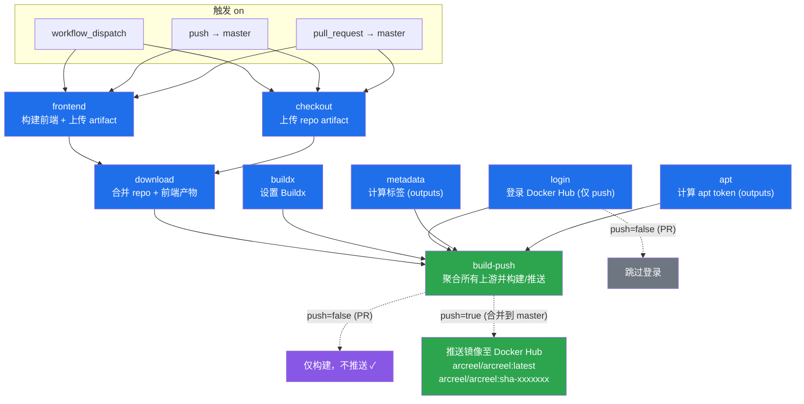

# docker-build 工作流图形化

> 对应 `docker-build.yml`。GitHub 原生渲染 Mermaid，直接预览本文件即可看到节点图。

## 节点说明

### Job: `frontend`（前端预构建）

| 节点 | Action | 触发条件 |
|------|--------|----------|
| ① Checkout | `actions/checkout@v4` | 总是 |
| ② Set up pnpm + Node 24 | `pnpm/action-setup@v4` + `actions/setup-node@v4` | 总是 |
| ③ pnpm install | `pnpm install --frozen-lockfile` | 总是 |
| ④ pnpm build | `pnpm build` | 总是 |
| ⑤ Upload artifact | `actions/upload-artifact@v4` | 总是（产物 `frontend-dist`）|

每个原 step 已拆为独立 job（共 8 个）：

| Job | 作用 | 触发条件 |
|-----|------|----------|
| `frontend` | 构建前端，上传 `frontend-dist` | 总是 |
| `checkout` | 上传 `repo` 源码 artifact | 总是 |
| `download` | 合并 repo + 前端产物为 `build-context` | needs: frontend, checkout |
| `buildx` | 设置 Buildx（图形节点；最终 build-push 会再设一次） | 总是 |
| `login` | 登录 Docker Hub（仅图形节点；最终 build-push 会再登录） | **仅 push 到 master** |
| `metadata` | 计算镜像标签/元数据，通过 `outputs` 传出 | 总是 |
| `apt` | 计算 weekly apt token，通过 `outputs` 传出 | 总是 |
| `build-push` | 聚合所有上游，下载 `build-context` 并构建/推送 | needs: download, buildx, login, metadata, apt |

**关键说明**：GitHub Actions 的每个 job 跑在独立 runner 上，`checkout` / `buildx` / `login` 的状态**无法跨 job 传递**。因此真正执行构建的 `build-push` 必须自行再 checkout（改为下载 `build-context` artifact）、设置 buildx、登录；`metadata` 与 `apt` 是通过 job 的 `outputs` 把值传给 `build-push`，`frontend`/`checkout` 的产物通过 artifact 传递。

**关键分支**：`pull_request` 触发时 `login` 跳过、`build-push` 只构建不推送；`push` 到 `master` 时才登录并推送镜像到 Docker Hub。
