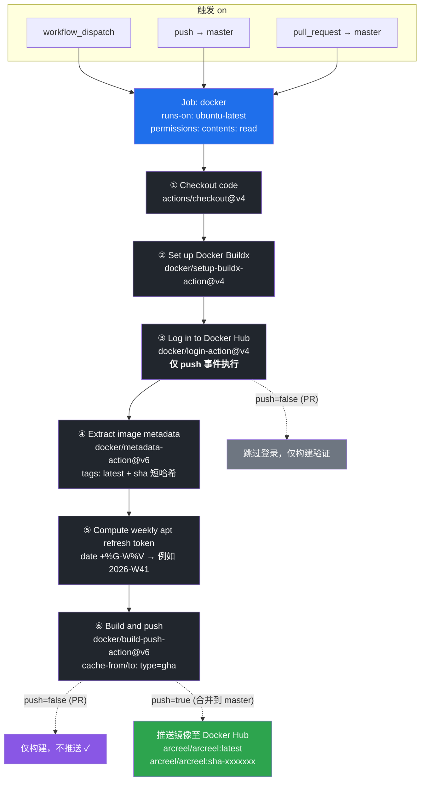

# docker-build 工作流图形化

> 对应 `docker-build.yml`。GitHub 原生渲染 Mermaid，直接预览本文件即可看到节点图。

## 节点说明

| 节点 | Action | 触发条件 |
|------|--------|----------|
| ① Checkout | `actions/checkout@v4` | 总是 |
| ② Buildx | `docker/setup-buildx-action@v4` | 总是 |
| ③ Login | `docker/login-action@v4` | **仅 push 到 master** |
| ④ Metadata | `docker/metadata-action@v6` | 总是（产出 `latest` + `sha` 标签）|
| ⑤ apt token | `date +%G-W%V` | 总是（按周刷新系统包缓存层）|
| ⑥ Build/Push | `docker/build-push-action@v6` | 构建总是；**推送仅 push 到 master** |

**关键分支**：`pull_request` 触发时 ③ 跳过、⑥ 只构建不推送；`push` 到 `master` 时才登录并推送镜像到 Docker Hub。
