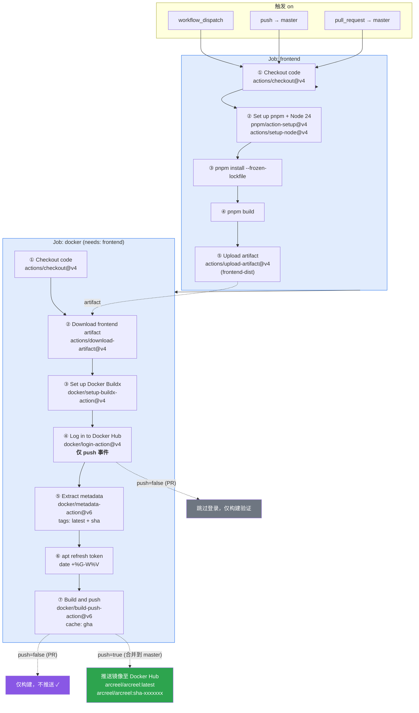

# docker-build 工作流图形化

> 对应 `docker-build.yml`。GitHub 原生渲染 Mermaid，直接预览本文件即可看到节点图。

## 节点说明

### Job: `frontend`（前端预构建）

| 节点 | Action | 触发条件 |
|------|--------|----------|
| ① Checkout | `actions/checkout@v4` | 总是 |
| ② Set up pnpm + Node 24 | `pnpm/action-setup@v4` + `actions/setup-node@v4` | 总是 |
| ③ pnpm install | `pnpm install --frozen-lockfile` | 总是 |
| ④ pnpm build | `pnpm build` | 总是 |
| ⑤ Upload artifact | `actions/upload-artifact@v4` | 总是（产物 `frontend-dist`）|

### Job: `docker`（needs: `frontend`）

| 节点 | Action | 触发条件 |
|------|--------|----------|
| ① Checkout | `actions/checkout@v4` | 总是 |
| ② Download artifact | `actions/download-artifact@v4` | 总是（取 `frontend-dist` → `frontend/dist`）|
| ③ Buildx | `docker/setup-buildx-action@v4` | 总是 |
| ④ Login | `docker/login-action@v4` | **仅 push 到 master** |
| ⑤ Metadata | `docker/metadata-action@v6` | 总是（产出 `latest` + `sha` 标签）|
| ⑥ apt token | `date +%G-W%V` | 总是（按周刷新系统包缓存层）|
| ⑦ Build/Push | `docker/build-push-action@v6` | 构建总是；**推送仅 push 到 master** |

**关键分支**：`pull_request` 触发时 ④ 跳过、⑦ 只构建不推送；`push` 到 `master` 时才登录并推送镜像到 Docker Hub。`docker` job 依赖 `frontend` 产出，必须等其完成。
