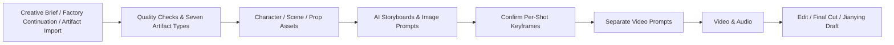

# Short Drama Factory Workflow {#workflows}

ArcReel uses the short drama factory for writing and video production. After creating a project, complete factory delivery, asset preparation, AI storyboarding, reference confirmation, separate video prompts, video generation, and editing.

## 1. Create a Factory Project {#two-dimensions}

Enter the project name, aspect ratio, visual style, total episode count, episode target, and model settings. Production uses drama storyboards with no content-mode or generation-route selector. Both live-action and animation styles are supported.

## 2. Factory Delivery and Reading {#content-sources}

### Factory Generation {#drama-flow}

**AI original script** supports new stories, continuations, and consecutive episodes. Enter the genre, creative brief, length tier, and total episode count, then hand the instructions to the Agent. It reads existing series artifacts and calls the configured strong text model.

Each episode goes through a first draft, doctor refinement, episode machine checks, repair, ledger updates, series machine checks, and compliance checks. Each passing batch is saved immediately. A failed check, failed report, or incomplete artifact set rejects the entire batch.

### Artifact Directory Import {#artifact-import}

For existing factory deliveries, open **Import script** from the overview, script, or storyboard page and select the artifact directory. ArcReel validates relative paths and seven artifact types, then stores the original Markdown:

- Character bible: `character-bible.md`;
- Series outline: `series-outline.md`;
- Continuity ledger: `ledger.md`;
- Episode plan: `episode-plan/episode_NN.plan.md`;
- Episode text: `episodes/episode_NN.md`;
- Machine report: `reports/episode_NN.machine.md`;
- Compliance report: `compliance/episode_NN.compliance.md`.

These files are stored under `source/short_drama/`. Existing series artifacts can be reused. Each delivered episode must include its plan, text, and both reports in the same batch; reports require the explicit final verdict `结果: PASSED`. Import runs the quality checks again. A novel, PDF, or single Markdown episode cannot satisfy this contract.

### Story Planning and Episode Script {#story-planning}

**Story planning** displays the character bible, series outline, ledger, and episode plans as read-only documents. The episode **Script** view displays the original `episodes/episode_NN.md`. Quality reports are stored in the project directory and are not yet displayed on the page.

Factory text is the source of truth for plot and dialogue. Revisions must pass the factory quality workflow and submit a complete artifact set. Pages do not edit the source directly. Delivery does not generate visual JSON or register assets automatically.

## 3. Assets and AI Storyboards {#content-modes}

### Episode Assets {#stage-reference-assets}

In the episode **Assets** view, check characters, scenes, and props; complete registrations, descriptions, and asset sheets. Missing registrations or descriptions block AI storyboarding. Reusing assets across episodes reduces changes in appearance, clothing, and locations.

### AI Storyboards {#drama-mode}

Open **Storyboards** to generate storyboard units and image prompts from the source and registered assets. Shot duration comes from project settings. Choose conservative, standard, or enhanced optimization. Existing storyboards can be rebuilt completely or only for selected shots; unselected shots are preserved.

AI output must cover the source while preserving dialogue and source anchors. Invalid output is sent back for repair. When retries are exhausted, generation fails without a mechanical fallback. `scripts/episode_N.json` stores visual production state and does not replace the factory source.

## 4. References and Separate Video Prompts {#video-production-routes}

### Shot Details and Keyframes {#storyboard-image-route}

Shot details list **References** before **Prompts**. The prompt section contains, in order:

1. **Storyboard prompt**: insert characters, scenes, and props with **Insert referenced assets**; image generation includes their asset sheets.
2. **Reference materials**: generate consecutive keyframes for one shot from its image prompt. The default is 2×2, with 2×3 and 3×3 options. Cells are numbered K0, K1, and so on, from left to right and top to bottom. Review the composite, then confirm the references to split and bind them.
3. **Video prompt**: write it separately after confirmation, inserting K-frame labels through **Insert reference materials**. Image and video prompts cannot be authored in the same generation.

Cancelling reference editing does not save it. After changing the grid size, regenerate and confirm it before generating video from shot details. Changed references prompt a recommendation to rewrite the video prompt. Each grid contains consecutive keyframes of one shot only.

### Inputs and Continuity {#shot-continuity}

Video generation submits the complete keyframe group, each cell once, and records the relationship between keyframes and the composite. The model must support the selected reference count and first/last frame inputs. Exceeding its limits blocks the entire batch; ArcReel does not remove keyframes.

Adjacent shots prefer the actual last frame of the previous video, then the saved user snapshot, then the last cell of the previous grid. If none is available, the shot opens on its own first cell and ends on its last cell. Regeneration preserves user snapshots.

Character reference audio follows the order of first spoken appearance, subject to the model’s clip-count and total-duration limits. Models requiring audio-image binding also require a keyframe target for each speaker.

## 5. Historical Projects and Upgrades {#historical-projects}

Historical narration, ad, and reference-video projects retain data, media, and versions for reading, archiving, and existing edits. Their old and shared generation entries cannot produce new content. Mode fields are preserved, and old JSON is never converted automatically into the seven factory artifacts.

To produce new content, create a factory project and provide a complete factory delivery. Submitted provider tasks that can resume continue with their stored task IDs; failed downloads remain retryable without submitting another paid request.

Built-in Agent files are updated by fingerprint: unchanged obsolete instructions are removed, while user customizations are preserved. External Agents should refresh the MCP tool list and use factory generation, artifact ingestion, and prompt-authoring tools.

## 6. Standard Production Stages {#production-stages}

Check the following factory stages. Validate a small sample before expanding the batch.

### Stage 1: Project Goals {#stage-project-goal}

Define:

- Publishing platform;
- Aspect ratio;
- Target duration;
- Audience;
- Visual style;
- Budget limit;
- Whether narration is needed;
- Whether further editing in Jianying is needed.

### Stage 2: Content Structure {#stage-content-structure}

Confirm:

- Plot order;
- Episode boundaries;
- The purpose of each shot;
- Characters, scenes, and props in each episode;
- Content that must not be rewritten.

Check the factory source, series continuity, and episode plan before preparing assets. Plot and dialogue changes return to factory repair and artifact ingestion; visual changes use AI storyboarding or prompt editing.

### Stage 3: Asset Images {#stage-assets-check}

Confirm:

- Main characters;
- Recurring costumes;
- Scenes;
- Key props;
- Style references.

#### Merge assets registered twice {#merge-assets}

When the same person, place, or object is registered as two assets (for example, "Old Wang" and "Wang Jianguo"), open the menu on one of the asset cards, choose **Merge into…**, and pick the asset of the same type to keep. Only characters, scenes, and props can be merged.

After the merge, references in every episode's script plan, final script, drafts, and prompt text point to the kept asset, and the merged asset's name and aliases become aliases of the kept asset. Derivatives of a merged character move to the kept character; a derivative with the same name as one the kept character already has merges into the existing one. The kept asset's description, sheet, and other settings do not change.

For characters, you can also choose **Derivative**: the merged character becomes a derivative of the kept character, keeping its description, and the derivative sheet needs generating. Visual references point to that derivative, dialogue speakers change to the kept character, and the merged character's name is not recorded as an alias.

The merged asset's description, sheet and version history, voice settings, reference image, and reference audio are not kept, and a merge can't be undone. Before you confirm, the dialog lists, per episode, how many references will be rewritten and how many storyboard images and videos will become stale. It also shows the merged asset's description so you can copy what you need into the kept asset.

#### Delete assets {#delete-assets}

Open the menu on an asset card and choose **Delete**. Before you confirm, the dialog checks references in every episode's script plan, final script, drafts, and prompt text:

- If the asset is referenced, the dialog says which episodes reference it and how many times. Deleting doesn't rewrite those references, so shots that reference the asset will be blocked at generation. To keep the references, choose **Merge instead…** to [merge it into another asset of the same type](#merge-assets).
- If nothing references the asset, the dialog only warns that deletion can't be undone.

Deleting a character also deletes its derivatives. Deletion can't be undone.

### Stage 4: Small Sample {#stage-sample-clips}

Start by producing:

- 1–2 characters;
- 2–4 storyboards;
- 1–2 video clips;
- A short narration segment.

Scale up batch production only after approving the sample.

### Stage 5: Batch Production {#stage-batch-production}

Before starting, confirm:

- Concurrency and RPM;
- Cost estimate;
- Provider quota;
- Failure retry strategy;
- Disk space.

#### Current, Stale, and Missing Artifacts {#artifact-currency}

ArcReel determines an artifact's state from the direct inputs used to generate it:

- **Current**: The formal artifact matches the current project, script, and selected version;
- **Stale**: The formal artifact still exists and can be previewed or exported, but a related input changed after it was generated;
- **Missing**: No usable formal artifact exists, so one must be generated;
- **Blocked**: A project reference or artifact record is damaged and must be repaired first. ArcReel will not treat it as missing and automatically pay to regenerate it.

By default, batch generation fills only missing items; both current and stale artifacts are preserved. After changing a prompt, character, narration, or another input, explicitly regenerate the affected shots if you want to refresh existing results. A same-named file in the project directory is not, by itself, a formal artifact. The project must retain either the artifact reference in its script or a verifiable version record.

### Stage 6: Quality Control and Export {#stage-qa-and-export}

Check:

- Character consistency;
- Scene continuity;
- Actions and eyelines;
- Narration synchronization;
- Subtitles;
- Clip order;
- Total duration;
- Final resolution;
- Whether the Jianying export can be opened.

## 7. Review Gates {#review-gates}

ArcReel's advantage is not “skipping review,” but placing review where the cost of rework is lower.

| Review Point | What to Do When It Fails | What Not to Do |
|---|---|---|
| Factory quality checks | Repair episode text, series continuity, and reports | Produce rejected content |
| Character assets | Redo the character design or description | Batch-generate storyboards with an incorrect character |
| Small storyboard sample | Correct composition and style | Generate the entire episode's videos immediately |
| Small video sample | Adjust the model, parameters, and action descriptions | Repeatedly test expensive models without a plan |
| Narration audition | Correct the voice, pace, and text | Generate every audio track at once |
| Final video preview | Adjust the order, duration, and transitions | Publish an unchecked version immediately |

## 8. Consistency Practices {#consistency-practices}

### Characters {#consistency-characters}

- Keep age, hairstyle, body type, and core costume descriptions fixed;
- Minimize unnecessary backgrounds in character assets;
- Give distinct identifying features to different main characters;
- Treat costume changes as explicit story states, not random prompt variations.

### Scenes {#consistency-scenes}

- Establish asset images for important scenes;
- Fix the spatial orientation and main decor;
- Avoid unnecessary changes in lighting and time of day within the same passage;
- Track where characters are positioned in the space.

### Props {#consistency-props}

- Create prop assets for story-critical items;
- Do not let the model invent important text, Logo details, or structures;
- When details drift, redo the affected shot first instead of concealing the problem with later shots.

## 9. Cost-Control Practices {#cost-control-practices}

- Start with low-cost samples, then move to high-quality batch production;
- Use high-quality models for character design and key cover images;
- Use more balanced models for ordinary storyboards;
- Confirm images before generating videos;
- Redo individual failed shots separately;
- Review the cost estimate before each batch;
- Do not submit an entire episode while the model configuration is uncertain;
- Save reusable character and scene assets.

## 10. Definition of Done {#definition-of-done}

An episode or short video is complete only when it meets at least the following conditions:

- The content structure has been confirmed;
- The main assets have been confirmed;
- Every shot has a clear purpose;
- Characters and key props have no obvious identity drift;
- Video clips transition cleanly;
- Narration and subtitles have been proofread;
- Actual costs have been reviewed;
- The final video or Jianying draft opens correctly;
- The project has been archived or backed up.
