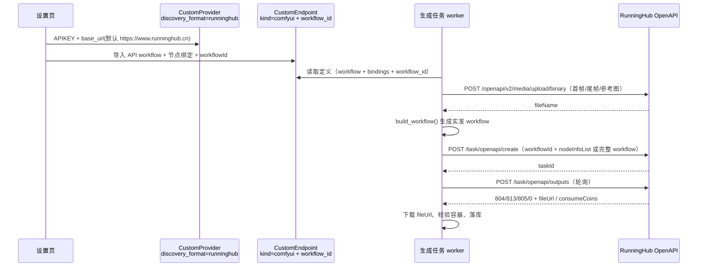

# 8. RunningHub 供应商接入方案

> 结论：**可以实现，但不能只当作“再加一个模型名”**。RunningHub 的 ComfyUI 工作流接口（workflowId + nodeInfoList）与 ArcReel 现有 ComfyUI 端点定义在“定义层”高度同构，在“传输层”完全不同；推荐复用现有 `comfyui` 端点定义，新增 `runninghub` 供应商传输协议，不改端点 kind、不复制节点绑定与能力推导。
>
> 状态：方案待评审。文中标「待验证」的接口行为（完整 workflow 传参、状态查询走 v1 还是 v2、`fieldValue` 类型）需先用真实 RunningHub 账号做 P0 联调确认。
>
> 实现进度（2026-10-31）：第一阶段已落地——`runninghub` 供应商协议、`workflow_id` 定义字段、客户端 / 执行层 / 视频与图像 backend、连通性探针、端点测试、拉取 workflow API、供应商与端点设置 UI、拉取弹窗、端点测试协议选择均已接入；用本地 mock RunningHub 服务验证了账户、上传、提交、轮询、下载与 backend 装配。**真实 RunningHub 账号的 P0 联调（尤其完整 workflow 传参是否生效、`fieldValue` 类型、真实错误码）仍待做。**
>
> 关联文档：ADR 0067（声明式端点）、ADR 0081/0082（ComfyUI 端点与节点绑定）、《6. 视频输入组织方案》（首帧 / 尾帧 / 参考图槽位）。

## 一、需求与结论

### 1.1 需求

在设置页新增 RunningHub 供应商，用户填入 RunningHub APIKEY 后，可以把远端保存的 ComfyUI 工作流（workflowId）当作 ArcReel 的图像 / 视频生成端点使用：

- 与现有自定义供应商一样，支持多 APIKEY、项目级覆盖、图像 / 视频独立并发；
- 工作流参数由现有节点绑定推导（提示词、首帧、尾帧、参考图、尺寸、帧数、seed 等）；
- 生成任务进入现有持久化任务队列，支持轮询、失败、取消、进程重启后续跑；
- 不要求用户在本机部署 ComfyUI。

### 1.2 结论

可行。RunningHub 提供三个可接入面：

| 接入面 | 与本项目的关系 | 结论 |
| --- | --- | --- |
| 原生 ComfyUI 代理 `https://www.runninghub.cn/proxy/{apiKey}` | 与现有 ComfyUI backend 的 `/prompt`、`/history`、`/upload/image`、`/view` 几乎同构 | 可做零代码 POC；因 APIKEY 在 URL 里、无 workflowId、无费用信息，不作为正式方案 |
| ComfyUI 工作流 OpenAPI（`/task/openapi/*`） | 定义层就是“workflow + 节点绑定”，与现有 `comfyui` kind 同构；传输层是 RunningHub 自己的任务模型 | **推荐正式方案** |
| 标准模型 API（`/openapi/v2/<family>/<task>`） | 上百个聚合模型（用户给的“全能视频 V3.1-pro 首尾帧”就属于这一类），不是工作流 | 独立议题，见第十节；本次不做或做 P3 |

## 二、RunningHub 接口面（以官方文档为准）

### 2.1 原生 ComfyUI 代理

```
24G 显存：https://www.runninghub.cn/proxy/{apiKey}
48G 显存：https://www.runninghub.cn/proxy-plus/{apiKey}
```

官方说明“该地址功能等同于本地部署的 ComfyUI 地址（`http://127.0.0.1:8188`）”，并给出了 EasyAI、SillyTavern、Krita 的接入方式。理论上现有 `ComfyuiClient` 只需把 `base_url` 指向该地址即可提交任意 API workflow。

问题：

- APIKEY 必须作为路径段，现有 `custom_provider.base_url` + `api_key` + `auth` 节（只支持 header / query）无法安全表达；把密钥拼进 `base_url` 会进日志、进错误信息、进导出。
- 没有 workflowId 语义，用不到 RunningHub 的“工作流”产品能力（保存、分享、加密访问）。
- 拿不到 `consumeCoins` / `taskCostTime`，费用页只能记 0。
- 取消依赖代理是否透传新版 `/api/jobs/{id}/cancel`、`/queue`、`/interrupt`，不可控。

结论：只用于 P0 验证“RunningHub 能不能跑我们的 workflow”，不作为产品方案。

### 2.2 ComfyUI 工作流 OpenAPI

| 用途 | 方法 / 路径 | 关键入参 | 关键出参 |
| --- | --- | --- | --- |
| 发起任务 | `POST /task/openapi/create` | `apiKey`、`workflowId`、`nodeInfoList`、`workflow`（可选，完整 JSON 字符串）、`usePersonalQueue`（企业独占 Key 显式启用个人队列）、`instanceType`（default/plus/ultra）、`webhookUrl`、`retainSeconds`、`accessPassword` | `data.taskId`、`data.taskStatus`、`data.promptTips` |
| 查询状态 | `POST /task/openapi/status` | `apiKey`、`taskId` | `data` 为 `QUEUED / RUNNING / FAILED / SUCCESS`；文档标 deprecated |
| 查询结果 | `POST /task/openapi/outputs` | `apiKey`、`taskId` | `code`：`0` 成功、`804` 运行中、`813` 排队中、`805` 失败、`807` 任务不存在；成功时 `data[]` 含 `fileUrl / fileType / taskCostTime / nodeId / consumeCoins` |
| 取消任务 | `POST /task/openapi/cancel` | `apiKey`、`taskId` | `code`：`0` 成功、`807` 任务不存在 |
| 拉取工作流 JSON | `POST /api/openapi/getJsonApiFormat` | `apiKey`、`workflowId` | `data.prompt` 为 API 格式 workflow 的 JSON 字符串 |
| 统一查询 V2 | `POST /openapi/v2/query` | `taskId` | `taskId / status / results[] / errorCode / errorMessage`，用于标准模型 API；是否覆盖工作流任务**待验证** |
| 文件上传 | `POST /openapi/v2/media/upload/binary` | multipart `file` | `data.fileName`（给 ComfyUI 节点用）、`data.download_url`（给标准模型 API 用，约一天有效） |
| 账户信息 | `POST /uc/openapi/accountStatus` | `apikey`（注意小写）+ Bearer | `remainCoins`、`currentTaskCounts`、`apiType` |

几个必须写进实现的细节：

- `workflow` 是**字符串**，不是对象；文档称“指定则忽略 workflowId”，但 `workflowId` 仍为必填，且必须是该账号下已存在的工作流。完整 workflow 是否真的生效，P0 必须验证。
- `nodeInfoList` 的 `fieldValue` 文档写 `any`，并注明“需与原字段类型一致”；示例脚本把值全部 `str()`。两种口径都试，P0 定。
- 官方明确“API 调用会强制重置 seed，需要保持 seed 就把 seed 放进 nodeInfoList”。
- 上传返回的 `fileName` 是服务端相对路径，不是外链；填入 `LoadImage` 等节点的是 `fileName`，不是 `download_url`。

### 2.3 标准模型 API（用户链接指向的那一类）

以“全能视频 V3.1-pro 首尾帧生视频-低价渠道版”为例：

```
POST /openapi/v2/rhart-video-v3.1-pro/start-end-to-video
{ prompt, firstFrameUrl, lastFrameUrl, aspectRatio, duration, resolution }
查询：POST /openapi/v2/query { taskId }
```

它要求 `firstFrameUrl / lastFrameUrl` 是 URL，而 ArcReel 的输入是本地文件；必须先上传到 RunningHub 拿 `download_url`（约一天有效）再拼请求。这属于“标准模型 API”接入，不是工作流，且每个模型一套参数，不能靠一份 workflow 定义覆盖。见第十节。

## 三、ArcReel 现状（代码级）

### 3.1 供应商与端点

- 自定义供应商：`lib/db/models/custom_provider.py`（`display_name` / `discovery_format` / `base_url` / `api_key` / lane 并发列）。
- 协议名录：`lib/custom_provider/discovery_formats.py`（`openai / google / comfyui`），`server/routers/custom_providers.py` 的 `DiscoveryFormatLiteral`。
- 自定义端点：`lib/db/models/custom_endpoint.py`，`definition` 是唯一真相源；`kind` 镜像列目前为 `declarative / comfyui`。
- 定义校验：`packages/arcreel-market-core/src/arcreel_market_core/endpoint_definition/validator.py` 按 `kind` 分派；`comfyui/schema.json` 定义 workflow + bindings。
- 投影：`lib/custom_provider/endpoints.py` 的 `comfyui_endpoint_spec()`；能力从绑定推导（ADR 0082）。
- 执行：`lib/custom_provider/comfyui/` 下的 `comfyui_client.py`（`/upload/image`、`/prompt`、`/history`、`/queue`、`/view`）、`comfyui_execution.py`（轮询、取件、取消）、`comfyui_backend.py` / `comfyui_image_backend.py`。
- 端点测试：`lib/custom_provider/endpoint_test/kinds.py` 按 kind 分派，`comfyui.py` 提供预览与测试连接。
- 连通性检查：`server/routers/custom_providers.py` 的 `_run_connectivity_check` / `_check_comfyui`。

### 3.2 现有 ComfyUI 端点能直接复用什么

| 能力 | 现有实现 | RunningHub 是否可复用 |
| --- | --- | --- |
| API workflow 导入、UI workflow 拒绝 | `comfyui/import_shapes.py`、`server/routers/custom_endpoints.py` | 是 |
| 节点绑定推断（提示词、首尾帧、参考图、输出节点） | `comfyui/inference.py`、`server/routers/comfyui_inference.py` | 是 |
| 尺寸 / 帧数 / seed / 首尾帧写值、节点裁剪 | `comfyui/request_builder.py` | 是（构造出的 workflow 即“实发稿”） |
| 能力推导（文本生视频、首帧、尾帧、参考图上限、音轨） | `comfyui/capabilities.py` | 是 |
| 绑定表校验、定义 schema、镜像列、市场索引 | `arcreel_market_core/comfyui/*`、`endpoint_resolution.py` | 是 |
| 上传素材、提交、轮询、取件、取消 | `comfyui_client.py`、`comfyui_execution.py` | **否**，四个运输动作全部不同 |
| 供应商协议、连通性检查、端点测试、设置页 | 见 3.1 | **否**，需要新增协议分支 |

结论：定义、绑定、能力、构造这四层可以原样复用；需要新写的是**传输层 + 协议接线 + 少量 UI**。

### 3.3 差距清单

| 动作 | ComfyUI 现态 | RunningHub 工作流 |
| --- | --- | --- |
| 上传素材 | `POST /upload/image`（multipart `image`，返回 `subfolder/name`） | `POST /openapi/v2/media/upload/binary`（multipart `file`，返回 `fileName`） |
| 提交 | `POST /prompt {prompt, client_id}` | `POST /task/openapi/create {apiKey, workflowId, nodeInfoList, workflow?}` |
| 轮询 | `GET /history/{prompt_id}`，`/queue` 辅助判丢失 | `POST /task/openapi/status` 或 `/outputs`（code 804/813/805/807） |
| 取件 | `GET /view?filename=...` | 直接下载 `data[].fileUrl` |
| 取消 | `/api/jobs/{id}/cancel` 或 `/queue` + `/interrupt` | `POST /task/openapi/cancel` |
| 认证 | `auth` 节（header/query） | `Authorization: Bearer <APIKEY>` + body `apiKey` |
| 费用 | 无 | `consumeCoins`、`taskCostTime` |
| 任务标识 | `prompt_id` | `taskId` |

## 四、方案对比

| 方案 | 做法 | 改动量 | 优点 | 缺点 | 结论 |
| --- | --- | --- | --- | --- | --- |
| A. 原生代理 | 自定义供应商协议仍为 `comfyui`，`base_url = https://www.runninghub.cn/proxy/<key>` | 0 行 | 当天可验证；任意 workflow；不会漂移 | APIKEY 进 URL/日志；无 workflowId、费用、实例档；取消不可控 | 仅 POC |
| B. 复用 comfyui 定义 + 新协议 | 新增 `discovery_format=runninghub`；定义加可选 `workflow_id`；`_build_comfyui_runtime` 按 provider 协议分叉 | 中（后端约 1.5–2k 行，前端约 0.6–0.8k 行） | 复用绑定/能力/导入/市场；密钥不进 URL；支持 workflowId、费用、取消、续跑 | 一个定义同时可挂本地/云端，需在供应商保存期约束 `workflow_id` | **推荐** |
| C. 新增 `runninghub` 端点 kind | 新 kind 独立 schema/validator/spec/UI 分支 | 大（B 的两倍以上） | 语义最纯 | 校验、镜像列、市场、能力、UI 条件分支全面复制；“workflow + bindings”本已同构 | 暂不 |
| D. 内置供应商 + 标准模型 API | 每个聚合模型一个 Python backend | 每个模型 2–3 天 | 开箱即用、无需导入 workflow | 100+ 模型不可维护；覆盖不了用户自定义工作流 | 仅少数主推模型 |

推荐 **B**：把 RunningHub 看作“ComfyUI 工作流的另一种运输方式”，而不是“另一种端点定义”。端点 kind 继续表示“定义长什么样”，供应商协议表示“发到哪里、怎么发”。这也符合现有 `discovery_format` 的语义（它已经是“连通性与模型发现按哪套接口进行”，`comfyui` 本身就是一种传输协议）。

## 五、推荐方案 B 详细设计

### 5.1 数据流



### 5.2 供应商协议

- 新增协议值 `runninghub`：
  - `lib/custom_provider/discovery_formats.py`：新增 `RUNNINGHUB_DISCOVERY_FORMAT`、`is_runninghub_protocol()`，并把 `is_comfyui_protocol()` 保留为“原生 ComfyUI”判据；新增 `is_workflow_protocol()`（`comfyui` 或 `runninghub`）。
  - `server/routers/custom_providers.py`：`DiscoveryFormatLiteral` 加 `runninghub`；`_check_protocol_constraints` 的配对判据改为 `endpoint_attachment_holds(endpoint_kind, discovery_format)`，即“workflow 端点只挂 workflow 协议”；能力覆盖关闭的判据从 `is_comfyui_protocol` 改为 `is_workflow_protocol`（文案另起一条或复用“该协议不支持覆盖”）。
  - `_run_discover`：`runninghub` 与 `comfyui` 一样返回“不适用”，不尝试模型发现。
  - 连通性检查：新增 `_check_runninghub`，`POST /uc/openapi/accountStatus`（body `apikey` + Bearer），成功文案带 `remainCoins`、`currentTaskCounts`；这是免费、无副作用的探针。
- 默认值：`base_url = https://www.runninghub.cn`，前端可改（例如私有化域名）；`api_key` 必填。
- 并发：沿用 `custom_provider` 的 lane 并发列；RunningHub 侧的队列/并发在 P0 记录，必要时在文档中给出建议值，不在代码里写死。
- 可选实例档：`instanceType`（default/plus/ultra）先不做；若做，放在供应商级配置，避免同一份 workflow 定义绑定到某一档机器。

### 5.3 定义扩展：`workflow_id`

在 `comfyui/schema.json` 顶层增加**可选**字段：

```json
"workflow_id": {
  "type": "string",
  "minLength": 1,
  "maxLength": 64,
  "description": "云端工作流服务（如 RunningHub）上的工作流 ID；本地自建 ComfyUI 留空。"
}
```

- 建议把 ComfyUI 定义版本升到 `1.1.0`（只加可选字段，结构向后兼容）：`COMFYUI_SCHEMA_VERSION` 与 `_CURRENT_SCHEMA_VERSION_BY_KIND` 同步；1.0.0 的旧定义继续通过校验，只在导入确认时提示“版本落后”。不升版本会让带 `workflow_id` 的定义在旧版应用里因 `additionalProperties: false` 被直接拒收，也没有版本提示可用。
- 定义校验器：`workflow_id` 若存在必须是字符串；是否要求全数字由 P0 决定（示例 ID 是纯数字，但不宜把厂商格式写进通用 schema）。
- 供应商保存期校验（`_check_protocol_constraints`）：当 `discovery_format == "runninghub"` 时，该供应商所有模型行挂的端点定义必须有非空 `workflow_id`，否则 422，文案指明“RunningHub 供应商需要为每个端点填写工作流 ID”。
- 端点更新期同样要校验：若该端点被任一 RunningHub 供应商的模型行引用，删空 `workflow_id` 应被拒绝，而不是等到生成时才失败。
- 反向不强制：带 `workflow_id` 的定义挂到本地 `comfyui` 供应商时不报错（字段被忽略），但在端点详情给一条提示。

为什么不把 `workflow_id` 放模型行：同一个 workflow 定义可以被多个模型行复用（不同别名 / 不同价格），而 ID 属于工作流本体，放定义层更稳；模型行继续只承担“模型别名 + 价格 + 能力覆盖”。

### 5.4 传输层实现

新增包 `lib/custom_provider/runninghub/`：

| 文件 | 职责 |
| --- | --- |
| `client.py` | `RunningHubClient`：base_url 归一化、Bearer 头、`upload_file()`、`create_task()`、`query_status()`、`query_outputs()`、`cancel()`、`account_status()`、`fetch_workflow_json()`；所有出站走 `artifact_http_client`（SSRF 防线），错误脱敏 |
| `execution.py` | `RunningHubExecution`：轮询到终态、判成败、取 `fileUrl`、下载、容器校验、超时/取消时叫停远端；`provider_job_id = taskId` |
| `backend.py` | `RunningHubVideoBackend` / `RunningHubImageBackend`：上传素材 → `build_workflow()` → 生成 nodeInfoList → 提交 → 持久化 taskId → 轮询取件 → 组装 `VideoGenerationResult` / `ImageGenerationResult` |
| `node_info.py` | 从 `BuiltWorkflow` 与定义底稿的差异生成 `nodeInfoList`（类型保持、排除连线、seed 必带） |

#### 提交形态（P0 二选一）

- **Mode F（首选）**：`create` 同时传 `workflow`（完整实发 workflow 的 JSON 字符串）与 `workflowId`。这样节点裁剪、首尾帧合并旁路、参考图数量变化都能原样生效，且不依赖远端工作流版本。`nodeInfoList` 只放 RunningHub 会强制覆盖的值（至少 seed；若 P0 发现其他字段也被重置，再补）。
- **Mode N（兜底）**：只传 `workflowId + nodeInfoList`，由 `node_info.py` 把差异写成节点字段。限制：`build_workflow()` 会裁剪 / 旁路节点，而 nodeInfoList 只能改值、不能删节点，因此带“按参考图张数改图 / 尾帧合并”的 workflow 只能用 Mode F；Mode N 需在保存或测试连接时给出明确限制。

#### nodeInfoList 生成规则（Mode N）

1. 以定义里的 `workflow` 为底稿，`build_workflow()` 的输出为实发稿；
2. 逐节点逐 `inputs` 比较，只收**标量**差异（字符串 / 数字 / 布尔）；
3. 排除链接值（`["12", 0]` 这类数组）与 `_meta`；
4. 上传得到的 `fileName` 已经在实发稿里，按普通字符串差异收；
5. 保持原值类型：`seed` / `steps` / `width` 等不要 `str()`，除非 P0 证明 RunningHub 只收字符串；
6. 若 `request.seed` 有值，即使与底稿相同也显式写入（RunningHub 会强制重置 seed）。

#### 生命周期

- 提交成功：`data.taskId` 落 `provider_job_id`；`provider_job_id` 在轮询前持久化（复用 `ProviderJobIdPersistenceMixin`），进程重启后 `resume_video` 直接轮询。
- 轮询：以 `/task/openapi/outputs` 为主（一次请求同时给状态与产物），`code` 映射：
  - `0` 成功 → 取 `data[]`，按 `fileType` / 扩展名挑视频或图片；
  - `804` 运行中、`813` 排队中 → 继续；
  - `805` 失败 → 取 `data.failedReason`（`node_name`、`exception_message`、`traceback`），失败码带节点名；
  - `807` 任务不存在 → 判“任务丢失”，生成路径可重试，续跑路径按 `ResumeExpiredError`；
  - 其他 → 未知状态，按可重试失败处理。
- 取件：直接 `GET fileUrl`，走 `artifact_http_client` + 最大字节数 + 容器校验（复用 `comfyui/artifacts.py` 的 `container_matches`）。
- 取消：`POST /task/openapi/cancel`；`807` 视为已结束，不报错。
- 超时：沿用 `poll_timeout_seconds`；RunningHub 排队可能较久，默认值与现有视频一致，必要时在设置页给“RunningHub 专用超时”。
- 结果：`task_id = taskId`；`video_uri = fileUrl`；`provenance.workflow_sha256` 沿用 `build_workflow()` 的指纹；`consumeCoins` / `taskCostTime` 先放 `warnings` 或 `provenance`（费用换算见 5.7）。

#### 错误码

新增一组 `runninghub_*`（复用现有读侧动作映射）：

| 码 | 触发 | 读侧动作 |
| --- | --- | --- |
| `runninghub_auth_failed` | 401 / `ApiKey verification failed` | 重新配置 APIKEY |
| `runninghub_workflow_not_found` | `workflowId` 不存在或无权限 | 检查工作流 ID |
| `runninghub_node_errors` | `promptTips.node_errors` 非空 | 重新绑定节点 / 重新导入 |
| `runninghub_task_failed` | `code=805` | 按 `failedReason` 展示节点名与异常 |
| `runninghub_task_lost` | `code=807` | 生成路径可重试；续跑判过期 |
| `runninghub_insufficient_coins` | 余额不足（P0 确认错误码） | 充值 |
| `runninghub_upload_failed` | 上传非 0 | 重试 / 检查文件类型 |
| `runninghub_timeout` | 轮询超时 | 稍后重试或加大超时 |

### 5.5 工作流同步与漂移

RunningHub 上修改工作流后，本地定义里的 workflow 会过期。两条处置：

1. **作者期主动同步**：端点详情提供“从 RunningHub 拉取”按钮，输入 workflowId + 选择 RunningHub 凭证，服务端调用 `/api/openapi/getJsonApiFormat` 取回 API 格式 JSON，替换 `workflow`，再跑一次绑定推断（`infer_bindings`），让用户确认。
2. **运行期兜底**：提交返回 `promptTips.node_errors` 时，直接失败并提示“远端工作流与本地定义不一致，请重新拉取并绑定”，不要进入轮询。

Mode F 下完整 workflow 会随请求发送，漂移影响小；Mode N 下必须做上面的检查。

### 5.6 前端改动

| 位置 | 改动 |
| --- | --- |
| `CustomProviderForm.tsx` | 协议下拉新增 `runninghub`（文案“RunningHub 工作流”）；`base_url` 预填 `https://www.runninghub.cn`；隐藏“获取模型列表”（与 ComfyUI 一样不适用）；连通性提示改为“使用账户信息探针，显示 RH 币与运行中任务数”；`api_key` 必填 |
| `customProviderHelpers.ts` / `customProviderFormState.ts` | 协议判据从 `=== "comfyui"` 扩展为 `isWorkflowProtocol()`；模型行端点选择器只列 `comfyui` 端点；能力覆盖在该协议下隐藏 |
| `EndpointDetail.tsx` / `ComfyuiEndpointDetail.tsx` | 增加“RunningHub 工作流 ID”输入与“从 RunningHub 拉取”按钮；当宿主供应商为 RunningHub 时该字段必填并给出说明；`auth` 节在该场景隐藏或折叠（RunningHub 用 Bearer，不用端点 auth） |
| `EndpointsSection.tsx` / `EndpointImportDialog.tsx` | 导入 workflow 后，若当前供应商是 RunningHub，弹窗补问 workflowId；仍走现有绑定编辑器，不新建一套导入 |
| `ComfyuiEndpointTestSection.tsx` | 凭证来源列表从“`discovery_format === comfyui`”扩展为“workflow 协议”；预览卡展示 `create` 请求体（apiKey 打码）；测试连接展示真实任务状态与 `consumeCoins` |
| i18n（zh/en/vi） | 新增协议名、字段说明、错误码文案；`comfyui_*` 通用文案可复用，不复制 |

> 页面结构、线框图、状态与文案见《[8.1 RunningHub 接入 UI 设计](8.1%20RunningHub%20接入%20UI%20设计.md)》。

### 5.7 后端改动清单

| 文件 / 模块 | 改动 |
| --- | --- |
| `lib/custom_provider/discovery_formats.py` | 新增 `runninghub` 常量与 `is_runninghub_protocol` / `is_workflow_protocol`；`endpoint_attachment_holds` 改为“workflow 端点 ↔ workflow 协议” |
| `lib/custom_provider/endpoints.py` | `comfyui_endpoint_spec` 的 `build_backend` 已收 `provider`，在 `_build_comfyui_runtime` 内按 `provider.discovery_format` 构造 `RunningHub*Backend`；其余 spec 属性（`size_fixed`、`duration_fixed`、`duration_tier_optional` 等）继续按 `kind == comfyui` 判定，不用改 |
| `lib/custom_provider/runninghub/`（新增） | 见 5.4 |
| `lib/custom_provider/endpoint_test/comfyui.py` | 预览 / 测试连接按协议分叉；`EndpointTestCredentials` 增加 `protocol` 字段（服务端已知 provider 协议，内联定义入口由调用方传入），或由 `workflow_id` 推断（后者不推荐，容易与真实宿主不符） |
| `lib/custom_provider/endpoint_test/kinds.py` | 仍按 `kind=comfyui` 分派；若 `trial_target` 需要协议，签名扩展为接收 protocol |
| `server/routers/custom_providers.py` | `DiscoveryFormatLiteral`；`_run_discover` 不适用；`_check_protocol_constraints` 配对与覆盖；`_run_connectivity_check` 增加 `_check_runninghub`；模型行保存时校验 workflow_id |
| `server/routers/custom_endpoints.py` | 导入 / 校验 / 保存时保留 `workflow_id`；新增“拉取 RunningHub workflow”接口（或复用 inference 入口） |
| `server/routers/comfyui_inference.py` | 拉取后的绑定推断复用现有 `infer_bindings`，不新增算法 |
| `packages/arcreel-market-core/.../comfyui/schema.json` | 加可选 `workflow_id`，版本升 `1.1.0`；`comfyui/validator.py` 校验类型；`endpoint_definition/validator.py` 的版本分派同步 |
| `lib/db/models/custom_endpoint.py` / `custom_provider.py` | 只改注释（kind 仍两值；`discovery_format` 补 runninghub），无需迁移 |
| `frontend/src/components/pages/settings/*` | 见 5.6 |
| `website/docs/guide/providers.md` + 供应商文档 | 增加 RunningHub 一节：如何导出 API workflow、如何填 workflowId、费用与限制 |

### 5.8 端点测试与连通性

- **连通性**：`POST /uc/openapi/accountStatus`，成功即“可达”，回显 `remainCoins`、`currentTaskCounts`；失败按现有 `ConnectivityCheckResponse` 软失败。
- **预览请求**：渲染 `POST /task/openapi/create` 的 body：`apiKey` 打码、`workflowId`、`nodeInfoList`（素材用摘要占位）、`workflow` 是否附带取决于 Mode F/N；附换算说明（width/height/frames/seed/负向提示词/删除节点），复用 `ComfyuiConversions`。
- **测试连接**：与生产同一条 backend 路径，提交一笔真实任务并轮询；结果体给出 `taskId`、状态迁移、`consumeCoins`、产物。测试端点费用不再是 0，`TrialRunTarget.gate_capabilities` 应为 `True`（与 ComfyUI 不同），因为 RunningHub 按次计费。
- **“验证响应”**：仍不适用（产物提取是固定 `fileUrl`，没有可配路径）。

### 5.9 费用与用量（P2）

`outputs` 返回 `consumeCoins` / `consumeMoney` / `taskCostTime`。建议：

- MVP：原样写进任务 `result.provenance` 与用量页备注，不换算；
- P2：模型行价格继续用人民币/秒或人民币/次；若用户想看 RH 币，新增“供应商实际成本”展示列，不参与 ArcReel 的价格计算，避免汇率与渠道版差异把预算算错。

## 六、P0 联调清单（编码前必须做）

用真实 RunningHub 账号，按顺序验证；每条都决定后面的实现形态：

| # | 实验 | 期望 / 判定 |
| --- | --- | --- |
| 1 | 原生代理 `GET /proxy/{key}/system_stats`、`POST /prompt`、`/history`、`/upload/image` | 若全通，方案 A 可作为 POC；不通则正式方案不受影响 |
| 2 | `POST /task/openapi/create` 只传 `workflowId + nodeInfoList` | 确认能跑通现有绑定字段（prompt / image / seed） |
| 3 | 同上，额外传 `workflow`（完整 JSON 字符串） | 确认是否真的覆盖远端 workflow；决定 Mode F/N |
| 4 | `nodeInfoList.fieldValue` 传 int / bool / 数组 | 确认类型口径；决定是否 `str()` |
| 5 | `outputs` 轮询全流程：0 / 804 / 813 / 805 / 807 | 确认状态码与 `failedReason` 结构 |
| 6 | `/openapi/v2/query` 查工作流 taskId | 若可用，优先用非 deprecated 的 V2；否则用 v1 |
| 7 | 上传图片 / 音频 / 视频，记录大小限制与返回字段 | 决定上传重试与格式白名单 |
| 8 | `cancel` 排队中 / 运行中 | 确认两种状态都能停 |
| 9 | `accountStatus` | 确认探针可用、返回字段 |
| 10 | `getJsonApiFormat` 权限与返回 | 决定“从 RunningHub 拉取”是否可做 |
| 11 | 并发 / 队列：同一 APIKEY 连发 2–5 笔 | 决定默认并发与超时建议 |
| 12 | 错误：错 APIKEY、错 workflowId、余额不足、节点错误 | 收集错误码，落 5.4 表 |

## 七、里程碑与工作量

估算基于熟悉本仓库的 1 名后端 + 1 名前端，单位为“人日”，**不含测试**（项目禁止跑测试，验收以真实账号联调 + 静态闸门为准）。

| 阶段 | 内容 | 工作量 |
| --- | --- | --- |
| P0 | 第六节 12 项联调，产出接口结论 | 0.5–1 |
| P1 后端 | 协议接线、定义字段、client/execution/backend、nodeInfoList、连通性、端点测试、错误码、文档 | 4–6 |
| P1 前端 | 协议选项、供应商表单、端点 workflowId/拉取、测试区、i18n | 2–3 |
| P1 收尾 | `uv run python scripts/gate.py backend frontend` 静态闸门、手工冒烟、文档 | 0.5–1 |
| P2 | webhook、instanceType、费用展示、市场发布、（可选）标准模型 API | 3–5 |

MVP（视频工作流 + 首尾帧/参考图 + 取消/续跑）约 **1.5–2 周**；只做后端 + 最小设置页可压到 1 周。

## 八、验收标准

功能：

1. 设置页可新增 RunningHub 供应商，APIKEY + 默认 base_url 保存成功，连通性检查显示 RH 币与运行中任务数。
2. 可导入 ComfyUI API workflow，填写 workflowId，绑定提示词 / 输出节点 / 首帧 / 尾帧 / 参考图，保存无诊断错误。
3. 模型行可挂该端点，项目中选择该模型后能生成视频；首帧、尾帧、参考图都上传到 RunningHub 并填入正确节点。
4. RunningHub 控制台能看到对应任务；ArcReel 任务状态从 running 到 completed，产物落盘且容器校验通过。
5. 失败场景（错 APIKEY、错 workflowId、节点错误、余额不足、任务失败）给出可读错误，不进入无限轮询。
6. 排队中 / 运行中取消能停远端；进程重启后续跑不重复提交。
7. `workflowId` 缺失时保存 RunningHub 供应商 / 模型行被 422 拒绝，文案指明补哪个字段。

非功能：

- APIKEY 只出现在 Authorization 头与请求体，不出现在 URL、日志、错误信息、导出定义里；
- 所有出站（提交、轮询、取件、上传）都经 `artifact_http_client`，拒绝链路本地与云元数据地址；
- 不新增测试命令，不编辑测试文件；`gate.py` 静态检查通过；
- 现有 ComfyUI 本地端点行为零回归（协议分叉默认走原路径）。

手工冒烟顺序：设置供应商 → 连通性 → 导入 workflow + workflowId → 绑定 → 测试连接 → 项目生成一镜 → 取消一笔 → 重启进程续跑一笔。

## 九、风险与对策

| 风险 | 影响 | 对策 |
| --- | --- | --- |
| `workflow` 完整传参不生效 | 只能走 nodeInfoList，节点裁剪/改图受限 | P0 第 3 项先定；不生效则 Mode N，并在绑定编辑器限制“会删节点”的编辑，或提示改用远端工作流 |
| `status` / `outputs` 已标 deprecated | 接口未来下线 | 传输层隔离；优先 `/openapi/v2/query`（若覆盖工作流任务），否则保留 v1 并加版本开关 |
| 远端工作流与本地定义漂移 | 节点错误、产物取不到 | 作者期“从 RunningHub 拉取 + 重新推断”；运行期 `promptTips.node_errors` 快速失败 |
| `fieldValue` 类型口径 | 提交失败或参数被字符串化 | P0 第 4 项；`node_info.py` 保留类型，必要时配置化 |
| APIKEY 权限/类型差异（普通/企业共享） | `instanceType`、`retainSeconds` 不可用；并发低 | P0 记录；MVP 不暴露实例档；并发建议写文档 |
| 队列久、冷启动 | 轮询超时误判失败 | 保留 `poll_timeout_seconds`；对 813 排队不计入失败预算；文档给建议超时 |
| 上传文件过期/大小限制 | 长任务取不到输入 | 上传后立即提交；记录限制；失败重试一次 |
| 费用币种与 ArcReel 价格体系不一致 | 预算页失真 | MVP 只展示实际消耗，不参与价格计算；P2 单独列 |
| 定义同时挂本地与云端 | 用户误配 | 供应商保存期校验 + 端点详情提示；不阻止（同一 workflow 可两处用） |

## 十、非目标与后续

本次不做：

- 标准模型 API（`/openapi/v2/<family>/<task>`）的逐模型接入。它需要“上传本地文件 → 拿 `download_url` → 拼 URL 参数”的通用上传能力，或为每个模型写 backend；与工作流是两条线。若只接用户给的那一个“全能视频 V3.1 首尾帧”，可先用 RunningHub 工作流包一层，或单独立项。
- RunningHub 的 TTS / 音频模型。**不是 RunningHub 没有 TTS**，而且有两条接法：
  - **自建 TTS 工作流**（用户已有 / 想搭的 workflowId）：需要把 workflow 端点扩展到 `media_type: audio`，复用现有 workflow 传输（提交 / 轮询 / 取件），新增音频产物与 `AudioBackend` 适配；推荐这条，音色、情感、后处理都可自定义。
  - **标准模型 API**（MiniMax Speech、Qwen3-TTS、豆包等）：`/openapi/v2/.../text-to-audio` + `/openapi/v2/query`，不需要 workflow；现有自定义端点只有声明式（image / video）与 `openai-tts`，声明式定义还未支持 `media_type: audio`。
  两条都不在本次工作流 MVP 范围内，放到后续或独立议题。
- Webhook 回调（MVP 用轮询；P2 可接 `webhookUrl`，但要做来源校验、幂等与重放）。
- 市场发布 RunningHub 端点（先验证本地可用，再考虑分享）。
- 原生代理模式的产品化（APIKEY 进 URL 的安全与审计问题）。

后续可做：

1. 标准模型 API 的通用“声明式上传”扩展：给 `endpoint_definition` 的 `inputs` 增加 `encoding: "upload"` 与 `upload` 节（URL、multipart 字段、响应提取），让 RunningHub 聚合模型可以只靠声明式定义接入；
2. **自建 TTS 工作流接入**（推荐给已有 TTS workflow 的用户）：`comfyui` 定义增加 `media_type: audio` 与音频绑定键（文本 / 音色 / 语速 / 输出），新增 `ComfyuiAudioBackend`（或 RunningHub 版）实现 `AudioBackend`，补音频产物扩展名与容器校验、端点测试与音频通道 UI；音色可固定在工作流里，也可绑定成节点输入。粗估 6–10 人日（不含自动推断 TTS 节点；若做自动推断再加 3–5 人日）。
3. **标准模型 API TTS**：声明式音频扩展（`media_type: audio`，模板 `{{ text }} / {{ voice }} / {{ speed }}`，提取 `audio_url`）约 3–5 人日，一份定义覆盖多个模型；或先做 MiniMax / Qwen3-TTS 专用 backend，每族 2–3 人日。
4. RunningHub 端点市场包：预置几套常用工作流定义（首尾帧、参考图、图生图、TTS），用户导入后只填 APIKEY 与 workflowId；
5. 费用对账：把 `consumeCoins` 落到用量明细，与 RunningHub 账单核对。

TTS 粗估（不含测试）：P0 联调 0.5 天；自建 TTS 工作流约 6–10 人日（音频媒体类型、绑定、`AudioBackend`、产物、端点测试、UI 音频通道；自动推断 TTS 节点再加 3–5 人日）；标准模型 API 声明式音频扩展约 3–5 人日，专用 backend 每模型族约 2–3 人日。接入后它会出现在「默认模型 → 旁白配音」与项目「设置 → 配音」，不经过视频任务桶。

## 十一、待确认

1. 本次目标是“用户自己的 ComfyUI 工作流”，还是“RunningHub 聚合模型（如链接里的全能视频 V3.1 首尾帧）”？两者方案不同；若两者都要，建议按本文 B 先做工作流，再单独立项标准模型 API。
2. 是否接受“复用 `comfyui` 端点定义 + 新增 `runninghub` 协议”的方案（而不是新增独立 `runninghub` kind）？前者改动小、复用高；后者语义更纯但成本约翻倍。
3. 是否已有 RunningHub 账号 / APIKEY 可做 P0 联调？P0 的 12 项结论会直接决定 Mode F/N、状态接口与错误码，未做 P0 就编码会返工。
4. 是否要把 RunningHub TTS 纳入本期？若有现成 TTS 工作流，推荐按“自建 TTS 工作流”接（workflow 端点扩展 `media_type: audio`，约 6–10 人日）；不想搭工作流则接标准模型 API（声明式音频扩展约 3–5 人日）。

## 十二、第二阶段建议

第一阶段已把“协议 + 传输 + 设置页 + 拉取 + 端点测试”跑通；第二阶段应先把真实账号下的形态钉死，再扩能力。建议按以下顺序，不要并行铺开：

| 阶段 | 内容 | 产出 / 验收 | 估算 |
| --- | --- | --- | --- |
| **2A. 真实账号 P0 与形态定稿（必须先做）** | 跑 12 项 P0：完整 workflow 传参、`fieldValue` 类型、`outputs` 错误码、v2 上传、并发/排队、取消/续跑；按结果调整提交形态与错误映射；补 fallback（完整 workflow 不支持时退回 nodeInfoList；v2 上传失败时退回旧上传） | 两个真实工作流（文生视频、首尾帧）各跑通一笔；取消与进程重启续跑各一笔；错误码与余额不足可读 | 2–3 人日 |
| **2B. 工作流生命周期** | 端点详情“从 RunningHub 重新拉取”与漂移提示；重新拉取后保留/重匹配已确认绑定；`promptTips` 节点错误快速失败；可选 `instanceType`（default/plus/ultra）与 `accessPassword` | 远端改版后可一键同步，不用删端点重建；缺 ID / 节点错误在保存或提交期暴露 | 3–5 人日 |
| **2C. 生产可用性收尾** | 供应商页“工作流端点”汇总与“保存并创建端点”；模型行缺 workflowId 的“去填写”；并发默认值；`consumeCoins` / `taskCostTime` 展示到任务与用量；schema 版本/ADR 定稿 | 新用户从添加供应商到生成不超过 5 个页面动作；任务页能看到 RH 币消耗；架构决策有 ADR | 3–5 人日 |
| **2D. TTS 工作流（若要）** | `media_type: audio`；绑定文本/音色/语速/输出；`AudioBackend` 适配；音频产物容器校验；端点测试音频试听；默认配音模型 / 项目配音；音色固定或绑定节点；参考音频克隆另算 | 一条自建 TTS workflow 生成旁白，出现在「默认模型 → 旁白配音」与项目「设置 → 配音」 | 6–10 人日 |
| **2E. 标准模型 API（若要）** | 声明式音频扩展 + 通用上传，或专用 backend；接 RunningHub 聚合模型（含用户最早链接的“全能视频 V3.1 首尾帧”） | 不建 workflow 也能选 RunningHub 的聚合模型；费用按次/秒 | 3–5 人日 |
| **2F. 可选增强** | webhook 回调、市场预置工作流（首尾帧/参考图/TTS）、费用对账、限流与重试策略 | 按业务优先级另排 | 3–5 人日 |

推荐里程碑：

- **M1（约 1 周）**：2A + 2B，做到“真实账号下稳定跑通，远端改版可同步”。
- **M2（约 1–2 周）**：2C + 2D（TTS），做到“普通用户可自助接入并用于旁白”。
- **M3**：2E 标准模型 API / 2F 市场与 webhook。

第二阶段开始前需要你提供：一个可用的 RunningHub APIKEY、两个真实 workflowId（一个文生视频、一个首尾帧或参考图），以及是否把 TTS 纳入 M2。拿到 APIKEY 后第一件事是跑 2A，而不是继续加功能。
