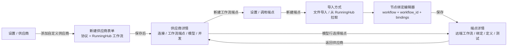

# 8.1 RunningHub 接入 UI 设计

> 状态：UI 方案已落地到设置页（供应商协议、workflowId 字段、端点测试协议选择、RunningHub 拉取弹窗）；本目录下的 HTML 原型仅用于评审。
>
> 配套《8. RunningHub 供应商接入方案》。目标：**不新增设置分区**，复用现有「供应商 + 调用端点」两页，把 RunningHub 的「账号 → 工作流 → 模型」三步显性化。
>
> 线框图用于对齐信息层级与交互，不约束具体像素；落地复用现有 `DetailPane` / `SecondaryRail` / `Section` / `FieldRow` / `SaveBar` / `Alert` / `Badge` 组件与 Tailwind 语义色。

## 一、设计目标

1. **30 秒看懂**：RunningHub 不是“又一个 OpenAI 兼容供应商”，而是“云端 ComfyUI 工作流供应商”；页面上要能一眼看到“账号 → 工作流 → 模型”的依赖关系。
2. **最短路径**：首次接入 5 步内完成；已有本地 ComfyUI 端点的用户，补一个 workflowId 即可复用。
3. **早失败**：APIKEY 无效、workflowId 缺失、远端工作流漂移、节点错误、余额不足，都在保存或测试阶段暴露，不等到生成任务跑到一半。
4. **与现有视觉一致**：二级栏 + 详情栏、分节标题、底部保存栏、`text-muted-foreground` / `text-warn` 语义色；不引入新的设计系统。
5. **费用可见**：RunningHub 按次扣 RH 币；测试连接与生成任务都要在动作前说清“会花钱”。

## 二、信息架构



入口原则：

- **供应商页**负责账号、模型别名、价格、并发；
- **端点页**负责工作流本体、workflowId、节点绑定；
- 两页互相深链，避免把“导入 workflow”塞进供应商表单。

## 三、关键流程

### 3.1 首次接入（5 步）

1. 设置 → 供应商 → 自定义 → “添加自定义供应商”。
2. 接入方式选 **RunningHub 工作流**；填名称、APIKEY（地址已预填 `https://www.runninghub.cn`），点“测试连接”看到 RH 币余额。
3. 在“工作流端点”空态点 **从 RunningHub 拉取**，填工作流 ID，拉取并进入绑定编辑器；确认提示词 / 首帧 / 尾帧 / 输出节点后保存。
4. 回到供应商页，“添加模型”：选刚保存的端点，填模型别名（如“首尾帧-全能V3.1”）、价格、并发。
5. 保存供应商，在项目里选择该模型生成。

### 3.2 已有本地 ComfyUI 端点迁到 RunningHub

1. 打开该端点 → “远端工作流”一节填 workflowId（或“从 RunningHub 重新拉取”）。
2. 新建（或编辑）一个 RunningHub 供应商，模型行选择同一个端点。
3. 页面提示“该端点同时可用于本地 ComfyUI；RunningHub 使用 workflowId，本地忽略它”。

不复制定义、不重建绑定；同一份 workflow 可以两处用。

### 3.3 远端工作流改版后重新同步

1. 端点详情出现提示：“远端工作流可能已更新”或生成失败返 `runninghub_node_errors`。
2. 点 **从 RunningHub 重新拉取** → 二次确认“会替换 workflow，并重新匹配节点绑定；无法匹配的绑定会被清空”。
3. 绑定表重跑推断，用户确认后保存。
4. 已有模型行与价格不动，只换 workflow 与绑定。

### 3.4 测试连接与排错

- 供应商页“测试连接”只验证账号（`accountStatus`），**不提交任务、不扣币**；
- 端点页“测试连接”会真实提交一笔任务并扣币，按钮旁必须写“测试会消耗 RH 币”；
- 失败卡直接给节点名与异常摘要，并给“重新拉取并绑定”的行动入口。

### 3.5 配置在哪里生效

供应商与端点页只负责“把能力配出来”；真正决定某次生成用不用 RunningHub 的是模型选择，层级与现有供应商一致：

1. **全局默认**：设置 → 默认模型 → 视频（默认 / 图生视频 i2v / 参考生视频 r2v）、图像（默认 / 文生图 t2i / 图生图 i2i）、文本、旁白配音（默认配音模型 / 音色 / 语速）。选 RunningHub 的模型行即成为全局默认。
2. **项目级覆盖**：项目 → 设置 → 模型（`/app/projects/<project>/settings?tab=models`）。项目里选中的模型优先于全局；留空 / “跟随全局”表示不覆盖。
3. **任务创建时锁定**：生成任务在创建时解析并锁定模型（ADR 0055）；之后改配置只影响新任务，不改变已提交 / 运行中的任务。

本次工作流方案只覆盖图像 / 视频通道；RunningHub 不提供对话 / 文本模型，但**确实提供 TTS，而且有两条接法**：

- **标准模型 API**：MiniMax Speech、Qwen3-TTS、豆包语音等，`/openapi/v2/.../text-to-audio` + `/openapi/v2/query`，不需要 workflow；
- **自建 TTS 工作流**：用户在 RunningHub 搭一个 TTS workflow（IndexTTS / GPT-SoVITS / MiniMax 节点等），像视频工作流一样用 workflowId 跑；这需要把 ArcReel 的 workflow 端点扩展到 `media_type: audio`。

本次没有把音频纳入，所以「默认配音模型」里暂时不会出现 RunningHub。若要做，推荐**自建 TTS 工作流**：可自定义音色、情感、后处理，且与现有 RunningHub 供应商/端点/模型行体系复用；标准模型 API 则适合不想搭工作流的通用 TTS。视频模型会按端点绑定能力进入 i2v / r2v 候选，图像模型进入 t2i / i2i 候选。若候选里看不到它，先检查模型行是否启用、端点 `media_type` 是否正确、绑定是否覆盖了该项目要用的输入槽位（首帧 / 尾帧 / 参考图）。

原型中的「使用位置」视图就是这一页的示意：全局默认模型、项目覆盖入口、生效顺序与在途任务提示。

## 四、线框图

### 4.1 新建供应商（RunningHub）

```text
┌ 设置 / 供应商 ─────────────────────────────────────────────────────────────┐
│ 供应商列表             │ 新建自定义供应商                                 │
│ 内置                   │ ┌ 接入方式 ────────────────────────────────────┐ │
│  Gemini                │ │ [OpenAI 兼容] [Google] [ComfyUI] [RunningHub]│ │
│  ...                   │ │                                   ▲ 选中     │ │
│ 自定义                 │ └──────────────────────────────────────────────┘ │
│  + 添加自定义供应商     │                                                  │
│                        │ 连接                                             │
│                        │ 名称   [RunningHub 云端工作流            ]        │
│                        │ 协议   RunningHub 工作流（保存后不可改）          │
│                        │ 地址   [https://www.runninghub.cn        ]        │
│                        │ 密钥   [••••••••••••••••••] [显示]               │
│                        │        [测试连接]                                 │
│                        │ ⓘ 连通后显示 RH 币余额与运行中任务数              │
│                        │                                                  │
│                        │ 工作流端点                                       │
│                        │ ┌ 还没有 RunningHub 工作流端点 ──────────────┐  │
│                        │ │ RunningHub 的“模型”来自工作流。先创建一个   │  │
│                        │ │ 端点，再回来添加模型。                       │  │
│                        │ │ [从 RunningHub 拉取]  [导入 workflow 文件]   │  │
│                        │ └─────────────────────────────────────────────┘  │
│                        │                                                  │
│                        │ 模型（0）                    [+ 手动添加模型]     │
│                        │ ┌ 还没有模型 ────────────────────────────────┐  │
│                        │ │ 先在上方创建工作流端点；没有端点时无法添加   │  │
│                        │ └─────────────────────────────────────────────┘  │
│                        │                                                  │
│                        │ 并发                                             │
│                        │ 图像 [  ]   视频 [  ]   音频 [  ]                │
│                        │                                      [保存]      │
└────────────────────────────────────────────────────────────────────────────┘
```

要点：

- 接入方式用四张可选卡片替代下拉（可选增强；不改也可用现有 `Select`，只是 RunningHub 发现性差）。
- “工作流端点”是 RunningHub 协议下新增的一节，空态直接给两条创建路径；不让用户先撞“模型端点为空”。
- “添加模型”在没有端点时禁用，鼠标悬停/下方说明原因。

### 4.2 供应商详情（已保存）

```text
┌ 设置 / 供应商 ─────────────────────────────────────────────────────────────┐
│ 供应商列表             │ [RH] RunningHub 云端工作流          [测试连接] ⋯ │
│ 内置                   │      RunningHub 工作流 · https://www.runninghub.cn│
│  ...                   │                                                  │
│ 自定义                 │ 连接                                             │
│  RunningHub 云端工作流 │ 名称 [RunningHub 云端工作流]                      │
│  + 添加自定义供应商     │ 协议 RunningHub 工作流（锁定）                    │
│                        │ 地址 [https://www.runninghub.cn]                  │
│                        │ 密钥 [••••••••••] [显示]                          │
│                        │ ✓ 连接成功：余额 99999 RH 币 · 运行中 0 个任务    │
│                        │                                                  │
│                        │ 工作流端点（2）              [+ 新建工作流端点]   │
│                        │ ┌────────────────────────────────────────────┐  │
│                        │ │ 首尾帧-全能V3.1      1904…346  2 个模型     │  │
│                        │ │                          [编辑] [测试]      │  │
│                        │ ├────────────────────────────────────────────┤  │
│                        │ │ 角色一致性-参考图     ⚠ 未填 workflow ID    │  │
│                        │ │                          [去填写]           │  │
│                        │ └────────────────────────────────────────────┘  │
│                        │                                                  │
│                        │ 模型（3）                    [+ 手动添加模型]     │
│                        │ ┌────────────────────────────────────────────┐  │
│                        │ │☑ 首尾帧-全能V3.1  端点: 首尾帧-全能V3.1  ⋯ │  │
│                        │ │☑ 角色一致性       端点: 角色一致性-参考图 ⋯ │  │
│                        │ └────────────────────────────────────────────┘  │
│                        │ ⚠ “角色一致性-参考图”缺少工作流 ID，保存后     │
│                        │   生成会失败。                                  │
│                        │                                                  │
│                        │ 并发 图像 [2] 视频 [3] 音频 [ ]                  │
│                        │                                      [保存]      │
└────────────────────────────────────────────────────────────────────────────┘
```

要点：

- “工作流端点”列表是**当前供应商模型行引用到的端点**的去重汇总，不是全局端点库；点击“编辑/去填写”跳到端点详情，返回时回到本供应商（复用现有 `from_provider` 返回链路）。
- 缺 workflowId 的行用 `text-warn` + 警示图标；供应商保存时若仍有缺失，底部保存栏报错并定位到该行。
- 供应商表单有未保存修改时点“新建工作流端点”，先弹“先保存供应商？”确认，避免跳走丢修改。

### 4.3 新建端点：从 RunningHub 拉取

```text
┌ 设置 / 调用端点 ───────────────────────────────────────────────┐
│ 我的端点             │ 新建端点                                 │
│  + 新建端点          │ ┌ 导入 workflow 文件 ─┐ ┌ 从 RunningHub 拉取 ─┐│
│                      │ │ 选择 .json          │ │ 选择 APIKEY + ID    ││
│                      │ └─────────────────────┘ └─────────────────────┘│
│                      │                                                  │
│                      │ 从 RunningHub 拉取工作流                          │
│                      │ 凭证来源  [RunningHub 云端工作流 ▾]               │
│                      │           或 [临时填写 APIKEY]                     │
│                      │ 工作流 ID [1904136902449209346]                   │
│                      │ ⓘ 在 RunningHub 工作流页复制链接末尾的数字         │
│                      │                                                  │
│                      │            [取消]  [拉取并解析]                   │
│                      │                                                  │
│                      │ ── 拉取成功 ─────────────────────────────────────│
│                      │ ✓ 已获取 API workflow：37 个节点                  │
│                      │ ✓ 已识别 4 个语义键（提示词/首帧/尾帧/输出）      │
│                      │ 媒体类型 [视频 ▾]                                  │
│                      │ [继续确认节点绑定]                                 │
└──────────────────────────────────────────────────────────────┘
```

要点：

- 拉取成功后不直接保存，先进入现有绑定编辑器；`workflow_id` 已填好，名称默认“RunningHub 工作流 <短 ID>”。
- 拉取失败（错 ID、无权限、网络）在原位 `Alert` 显示服务端错误码与建议，不关闭弹窗。
- 凭证来源优先列 RunningHub 供应商；没有供应商时默认“临时填写 APIKEY”，并给“先去创建供应商”的次链接。
- 媒体类型必须让用户确认：RunningHub 返回的 prompt 不含“产图/产视频”声明。

### 4.4 端点详情（RunningHub）

```text
┌ 设置 / 调用端点 ───────────────────────────────────────────────────────────┐
│ ← 返回 RunningHub 云端工作流                                                │
│ 首尾帧-全能V3.1   [RunningHub 工作流] [视频]            [重新导入] ⋯       │
│ ce-12 · 37 个节点                                                          │
│ ────────────────────────────────────────────────────────────────────────── │
│ 使用情况：2 个模型行正在使用                                                │
│                                                                            │
│ 远端工作流                                                                  │
│ RunningHub 工作流 ID  [1904136902449209346] [复制] [在 RunningHub 打开 ↗]  │
│ [从 RunningHub 重新拉取]                                                   │
│ ⓘ 重新拉取会替换 workflow 并重新匹配节点绑定；无法匹配的绑定会被清空。       │
│                                                                            │
│ 节点绑定                                                                    │
│ ┌ 语义键       状态        绑定节点                    操作 ─────────────┐ │
│ │ 提示词       ✓ 已确认    CLIPTextEncode #6          [重新识别]        │ │
│ │ 首帧         ✓ 已确认    LoadImage #10               [重新识别]        │ │
│ │ 尾帧         ✓ 已确认    LoadImage #11               [重新识别]        │ │
│ │ 输出         ✓ 已确认    SaveVideo #17               [重新识别]        │ │
│ └────────────────────────────────────────────────────────────────────────┘ │
│                                                                            │
│ 定义                                                                        │
│ 名称 [首尾帧-全能V3.1]   媒体类型 [图片] [视频●]                            │
│ 反向代理凭据（本地 ComfyUI 用；RunningHub 使用 APIKEY，本节不生效）  [展开] │
│                                                                            │
│ workflow 本体                                                               │
│ [CLIPTextEncode ×2] [LoadImage ×2] [KSampler ×1] [SaveVideo ×1] …          │
│                                                                            │
│ 端点测试                                                                    │
│ 发送到 [RunningHub 云端工作流 ▾]   ⚠ 测试会真实提交一笔任务并消耗 RH 币     │
│ 提示词 [……] 比例 [9:16] 分辨率 [原生] 时长 [5]                             │
│ 素材：首帧 [选择文件] 尾帧 [选择文件]                                       │
│ [预览请求] [测试连接]                                                       │
└────────────────────────────────────────────────────────────────────────────┘
```

要点：

- 页头加 `RunningHub 工作流` 徽标；workflowId 行是该端点与本地 ComfyUI 端点的唯一差别。
- 凭据节不删除：同一端点仍可给本地 ComfyUI 用；有 workflowId 时加一句“RunningHub 不读本节”。
- 测试区按宿主协议切换：选 RunningHub 供应商时发 `create`，选本地 ComfyUI 供应商时发 `/prompt`。

### 4.5 模型行与端点选择

```text
模型行（展开）
┌────────────────────────────────────────────────────────────────────────────┐
│ 启用 ☑   模型 ID [首尾帧-全能V3.1]   显示名 [首尾帧-全能V3.1]              │
│ 端点 [RunningHub 工作流 / 首尾帧-全能V3.1 ▾]                              │
│       ┌──────────────────────────────────────────────────────────────┐    │
│       │ RunningHub 工作流                                            │    │
│       │   ✓ 首尾帧-全能V3.1        RH · 1904…346 · 已绑定           │    │
│       │   ⚠ 角色一致性-参考图      RH · 缺少工作流 ID   [去填写]     │    │
│       │ 本地 ComfyUI                                                │    │
│       │   · SDXL 本地              本地 · http://127.0.0.1:8188      │    │
│       └──────────────────────────────────────────────────────────────┘    │
│ 价格 [0.00] 元/秒    时长 [由工作流固定]    分辨率 [由工作流推导]          │
│ ⓘ 模型 ID 只是 ArcReel 内的别名，不会发给 RunningHub；真正执行的是工作流。  │
└────────────────────────────────────────────────────────────────────────────┘
```

要点：

- 端点下拉按“RunningHub 工作流 / 本地 ComfyUI”分组；缺 workflowId 的选项禁用并给“去填写”。
- 能力覆盖（首尾帧开关）在该协议下隐藏，与现有 ComfyUI 行为一致。
- 时长/分辨率仍按绑定推导展示；无档位时显示“由工作流固定”，不假装可编辑。

### 4.6 测试结果卡

```text
测试连接（RunningHub）
┌────────────────────────────────────────────────────────────────────────────┐
│ 提交 ✓ ── 排队 ✓ 2s ── 运行 ✓ 35s ── 成功 ✓                 17 RH 币     │
│ taskId 1910246754753896450  [复制]        耗时 37s                         │
│ 产物  ComfyUI_00001.mp4 · 1080×1920 · 8.4 MB        [预览] [下载]         │
└────────────────────────────────────────────────────────────────────────────┘

失败
┌────────────────────────────────────────────────────────────────────────────┐
│ 提交 ✓ ── 运行 ✕                                                           │
│ 节点 SaveVideo 失败：'str' object has no attribute 'shape'                 │
│ [复制错误]  [重新拉取并绑定]  [查看原始响应]                                │
└────────────────────────────────────────────────────────────────────────────┘
```

要点：

- 状态用四段点 + 文案，不用百分比进度（RunningHub 不给百分比）。
- 费用只在成功后显示；排队/运行中显示“预计消耗？”，不编造金额。
- 失败卡给“重新拉取并绑定”行动，而不是让用户自己猜节点。

## 五、组件与状态

| 区域 | 组件 / 复用 | 关键状态 |
| --- | --- | --- |
| 接入方式 | 新 `ProtocolCards`（可选）或现有 `Select` | 选中、锁定（编辑态）、禁用（端点接线已定协议） |
| 连接区 | `FieldRow` + `Input` + `InputGroup` + `Alert` | 空、填写中、测试中、成功（余额）、失败（401/网络/域名） |
| 工作流端点列表 | 新 `WorkflowEndpointList` | 空、有端点、缺 workflowId、加载中、端点被删 |
| 模型表 | `CustomProviderModelTable` + `EndpointSelect` | 无端点、端点缺 ID、正常、行展开 |
| 拉取弹窗 | 新 `RunningHubPullDialog` | 初始、拉取中、成功（节点数/识别数）、失败、需要选媒体类型 |
| 远端工作流节 | 新 `RunningHubWorkflowSection` | 有 ID、无 ID、重新拉取确认、拉取中、漂移警告 |
| 绑定表 | 现有 `ComfyuiBindingTable` | 推断中、有阻断、已确认、重新识别中 |
| 测试区 | 现有 `ComfyuiEndpointTestSection` 扩展 | 预览中、预览失败、试跑排队/运行/成功/失败、余额不足 |
| 任务/用量 | 现有卡片 + `Badge` | RunningHub 来源、taskId、实际消耗（P2） |

### 5.1 校验与禁用

- 供应商表单：`RunningHub` 协议下 APIKEY 必填；模型行缺端点或端点缺 `workflow_id` 时保存栏阻断，错误文案定位到具体行。
- 端点表单：`workflow_id` 可选（本地 ComfyUI 不需要），但若该端点被 RunningHub 模型行引用，删除/清空时阻断。
- 测试连接：未选凭证来源、未填 APIKEY、未绑定必需节点时按钮禁用并给原因。

### 5.2 空态 / 错误态 / 加载态

- 供应商无端点：空态卡片 + 两个 CTA（拉取 / 导入），不显示“添加模型”。
- 供应商无模型：空态说明“先有端点，再加模型”，链接到端点列表。
- 端点无 workflowId：详情顶部 `Alert`（warn）+ “填写”按钮；供应商页同步显示。
- 拉取失败：弹窗内 `Alert` 保留用户输入，可重试；不关闭弹窗。
- 漂移：端点详情 `Alert`（warn）+ “重新拉取”；生成失败卡复用同一行动。
- 余额不足：测试/提交前 `Alert`（destructive）+ “去 RunningHub 充值”外链。
- 加载：沿用现有 `Loader2` + 文案；拉取/试跑期间禁用重复提交。

### 5.3 确认与费用

- “重新拉取”必须二次确认，写清“替换 workflow、重匹配绑定、可能清空手动绑定”。
- “测试连接”首次点击给一次轻量确认（或按钮旁常驻费用提示），避免误扣币。
- 从供应商页跳端点页且表单有未保存修改：先问“保存后离开 / 放弃修改 / 取消”。
- **新建供应商时的端点 CTA**：表单尚未保存，直接跳走会丢输入。点“从 RunningHub 拉取 / 新建工作流端点”时，先做最小校验（名称、地址、密钥），保存供应商（允许 0 模型），再带 `from_provider` 返回目标跳转；保存失败留在原页并显示原因。已保存供应商则直接跳转，有未保存修改时先确认。
- 端点保存后回到供应商页，端点目录刷新，模型行的端点下拉自动包含新端点；不要求用户手动刷新页面。

### 5.4 无障碍与响应式

- 所有输入有 `<label>` / `aria-describedby`；错误用 `role="alert"`；绑定表保持现有键盘操作。
- 测试区沿用容器查询：窄屏单列、宽屏四列；模型表横向滚动。
- 徽标不只靠颜色：缺 workflowId 同时有警示图标与文字。
- 外链统一 `target="_blank" rel="noopener noreferrer"`。

## 六、文案（zh / en）

| key | zh | en |
| --- | --- | --- |
| `discovery_format_runninghub` | RunningHub 工作流 | RunningHub workflow |
| `cp_runninghub_connect_hint` | 连通后显示 RH 币余额与运行中任务数；本检查不提交任务、不扣币。 | Shows RH coin balance and running tasks. No task is submitted. |
| `cp_runninghub_endpoints_empty_title` | 还没有 RunningHub 工作流端点 | No RunningHub workflow endpoint yet |
| `cp_runninghub_endpoints_empty_desc` | RunningHub 的“模型”来自工作流。先创建一个端点，再回来添加模型。 | Models come from workflows. Create an endpoint first. |
| `cp_runninghub_pull` | 从 RunningHub 拉取 | Pull from RunningHub |
| `cp_runninghub_import_file` | 导入 workflow 文件 | Import workflow file |
| `cp_workflow_id_missing` | 缺少工作流 ID，生成会失败。 | Missing workflow ID; generation will fail. |
| `cp_model_id_runninghub_help` | 模型 ID 只是 ArcReel 内的别名，不会发给 RunningHub；真正执行的是工作流。 | The model ID is a local alias only; the workflow decides what runs. |
| `ce_rh_section` | 远端工作流 | Remote workflow |
| `ce_rh_workflow_id` | RunningHub 工作流 ID | RunningHub workflow ID |
| `ce_rh_open` | 在 RunningHub 打开 | Open in RunningHub |
| `ce_rh_pull` | 从 RunningHub 重新拉取 | Re-pull from RunningHub |
| `ce_rh_pull_confirm` | 重新拉取会替换 workflow 并重新匹配节点绑定；无法匹配的绑定会被清空。 | Re-pulling replaces the workflow and re-matches bindings; unmatched bindings are cleared. |
| `ce_rh_auth_note` | RunningHub 使用 APIKEY；本地 ComfyUI 的反向代理凭据在本节配置，RunningHub 不读取。 | RunningHub uses the API key; the auth section only applies to self-hosted ComfyUI. |
| `ce_rh_test_cost` | 测试连接会真实提交一笔任务并消耗 RH 币。 | A trial run submits a real task and consumes RH coins. |
| `ce_rh_status_queued` | 排队中 | Queued |
| `ce_rh_status_running` | 运行中 | Running |
| `ce_rh_status_success` | 成功 | Succeeded |
| `ce_rh_status_failed` | 失败 | Failed |
| `ce_rh_coins` | {{n}} RH 币 | {{n}} RH coins |
| `ce_rh_err_auth` | APIKEY 无效或已失效，请检查供应商凭据。 | Invalid or expired API key. |
| `ce_rh_err_workflow` | 工作流不存在，或当前 APIKEY 无权访问。 | Workflow not found or not accessible with this key. |
| `ce_rh_err_node` | 节点 {{node}} 执行失败：{{message}} | Node {{node}} failed: {{message}} |
| `ce_rh_err_drift` | 远端工作流与本地定义不一致，请重新拉取并确认绑定。 | The remote workflow changed; re-pull and confirm bindings. |
| `ce_rh_err_coins` | RH 币不足，任务未提交。 | Insufficient RH coins; task not submitted. |

英文按现有 i18n 语气精简；越南语同步补齐（可后置，但 key 结构一次定好）。

## 七、前端改动清单

| 文件 | 改动 |
| --- | --- |
| `frontend/src/components/pages/settings/CustomProviderForm.tsx` | 协议选项加 RunningHub（或换 `ProtocolCards`）；连接区提示；新增“工作流端点”节；模型区空态与阻断；保存校验 |
| `frontend/src/components/pages/settings/customProviderHelpers.ts` | `isRunninghubProtocol` / `isWorkflowProtocol`；端点徽标与缺失判断 |
| `frontend/src/components/pages/settings/CustomProviderModelTable.tsx` | 端点下拉分组/徽标；缺 workflowId 禁用与“去填写”；隐藏能力覆盖；模型 ID 说明 |
| `frontend/src/components/pages/settings/EndpointSelect.tsx` | 选项渲染扩展（分组、徽标、禁用原因） |
| `frontend/src/components/pages/settings/endpoints/EndpointsSection.tsx` | 新建端点面板加“从 RunningHub 拉取”入口；草稿保存后刷新 |
| 新 `frontend/src/components/pages/settings/endpoints/RunningHubPullDialog.tsx` | 凭证来源、workflowId、拉取、成功预览、错误重试 |
| 新 `frontend/src/components/pages/settings/endpoints/RunningHubWorkflowSection.tsx` | 端点详情“远端工作流”节：ID、复制/打开、重新拉取、确认、漂移提示 |
| `frontend/src/components/pages/settings/endpoints/EndpointDetail.tsx` | 凭证来源过滤改为 workflow 协议；传 protocol 给测试区 |
| `frontend/src/components/pages/settings/endpoints/ComfyuiEndpointDetail.tsx` | 插入远端工作流节；页头徽标；auth 提示；测试区标题/说明 |
| `frontend/src/components/pages/settings/endpoints/ComfyuiEndpointTestSection.tsx` | 协议感知的凭证来源、费用提示、状态时间线、错误卡 |
| `frontend/src/components/pages/settings/customProviderFormState.ts` | 表单协议/端点状态；缺失 workflowId 的派生错误 |
| `frontend/src/api.ts` / `frontend/src/types/*` | 拉取接口、`workflow_id` 字段、`discovery_format` 联合类型、连接结果的结构化账户字段 |
| `frontend/src/i18n/{zh,en,vi}/dashboard.ts` | 上表 key |
| `frontend/src/components/shared/ProviderIcon.tsx` 或 `CustomProviderGlyph` | RunningHub 用工作流/云图标或名称首字，不猜品牌 |

## 八、UI 所需接口契约

1. **拉取工作流**：`POST /custom-endpoints/pull-runninghub`
   入参：`{ provider_id }` 或 `{ base_url, api_key }`，加 `workflow_id`；
   出参：`{ definition, inference }`（definition 已带 `workflow_id`，inference 与现有绑定推断同形）。
2. **连接检查结构化**：`ConnectivityCheckResponse` 增加可选 `account`：
   `{ remain_coins?: string, running_tasks?: string, api_type?: string }`；前端不再解析 message 取余额。
3. **端点测试凭证**：`EndpointTestCredentials` 增加 `protocol`（`comfyui` / `runninghub`），预览与试跑据此分叉；内联凭证入口提供协议选择。
4. **保存期错误**：供应商/端点保存返回结构化字段（如 `missing_workflow_id: [model_id]`），前端定位到具体行；退化为 detail 文案也可，但定位能力会差。
5. **错误码**：沿用 5.4 的 `runninghub_*`；前端按码给行动（重新配置 / 重拉绑定 / 充值 / 重试）。

## 九、验收标准

- 新用户从“供应商列表”到“项目里可选模型”不超过 5 个页面动作，且中途没有死路（每个空态都有下一步）。
- 缺 APIKEY、缺 workflowId、端点未绑定、余额不足四种情况，都在保存或测试阶段有可见提示，且提示里带修复入口。
- 供应商“测试连接”不扣币；端点“测试连接”扣币前有明确提示。
- 同一端点同时挂本地 ComfyUI 与 RunningHub 时，页面明确说明差异，不出现“到底发到哪”的歧义。
- 拉取/重拉/试跑都有加载态与失败重试；失败不丢用户输入。
- 窄屏（<768px）下表单单列可完成全部操作；模型表可横向滚动。
- 颜色不是唯一信息载体：缺 ID、失败、漂移均有文字或图标。
- 不新增设计系统依赖；复用现有 shadcn/Tailwind 组件与语义色。
